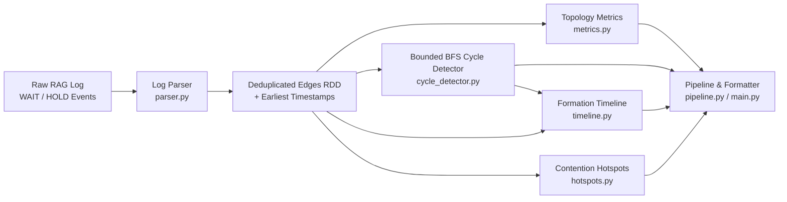
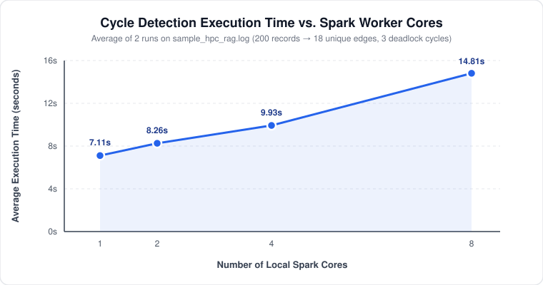
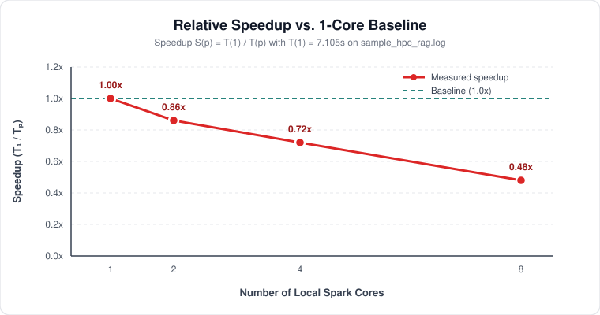

# Spark Deadlock Detector

**Distributed Resource Allocation Graph (RAG) Analyzer & Deadlock Cycle Detection Engine in PySpark**

`Python 3.10+` | `Apache Spark 3.4.1+` | `MIT License` | `Modular RDD Pipeline`

A scalable MapReduce analytics engine that ingests HPC resource allocation logs, constructs a distributed Resource Allocation Graph (RAG), detects deadlock cycles via bounded breadth-first RDD path propagation, reconstructs daily deadlock formation timelines, and ranks resource contention hotspots.

---

## Key Capabilities

- **Distributed RAG Construction**: Parses `WAIT` (request) and `HOLD` (allocation) event streams into deduplicated directed edges while preserving each edge's earliest occurrence timestamp.
- **Bounded Iterative BFS Cycle Detection**: Implements a MapReduce path-propagation engine in PySpark RDDs using `(start_process, current_node)` state pruning and canonical rotation filtering to eliminate duplicate cycle permutations.
- **Deadlock Formation Timeline**: Computes the exact date each deadlock cycle first became fully formed (when its final constituent edge appeared) and aggregates daily formation frequencies.
- **Contention Hotspot Analytics**: Ranks the top-K most contested resources (highest in-degree) and most blocked processes (highest out-degree), preserving zero-degree nodes via left outer joins with deterministic tie-breaking.
- **Dual Output Modes**: Supports both a compact machine-readable format (for automated pipelines) and a rich `--pretty` summary report for interactive inspection.

---

## System Architecture



For a deep dive into state pruning, canonicalization, and RDD cache lifecycle management, see [`docs/ARCHITECTURE.md`](docs/ARCHITECTURE.md).

---

## Quick Start

### Prerequisites

- **Python** 3.10+
- **Apache Spark / PySpark** 3.4.1+
- **Java** 11+ (required by the Spark JVM runtime)

### Installation

```bash
python3 -m venv .venv
source .venv/bin/activate
pip install -r requirements.txt
```

### Running the Analyzer

Run via `spark-submit` (recommended):

```bash
spark-submit main.py data/sample_hpc_rag.log 4
```

Or run directly with Python in local Spark mode:

```bash
python3 main.py data/sample_hpc_rag.log 4
```

For a human-readable sectioned report, pass `--pretty`:

```bash
spark-submit main.py data/sample_hpc_rag.log 4 --pretty
```

### CLI Options

```text
usage: spark-deadlock-detector [-h] [--max-cycle-length MAX_CYCLE_LENGTH]
                               [--top-k TOP_K] [--pretty]
                               log_file num_cores

positional arguments:
  log_file              Path to the resource allocation log file
  num_cores             Number of local Spark worker cores (positive integer)

options:
  --max-cycle-length    Maximum directed cycle length in edges (default: 25)
  --top-k               Number of top contention hotspots to report (default: 5)
  --pretty              Render a human-readable summary instead of compact output
```

---

## Input Log Format

Each whitespace-delimited record captures a single resource request or allocation event:

```text
2025-10-31 21:07:53	WAIT	P106	R006
2025-10-31 21:07:54	HOLD	P101	R006
2025-10-31 21:07:55	WAIT	P101	R002
2025-10-31 21:07:56	HOLD	P106	R002
```

| Event Type | Graph Edge Direction | Semantics |
| :---: | :---: | :--- |
| `WAIT` | `Process -> Resource` | Process is blocked requesting the resource |
| `HOLD` | `Resource -> Process` | Resource is currently allocated to the process |

---

## Sample Output (`data/sample_hpc_rag.log`)

Running on the bundled 200-record sample dataset produces:

- **Graph Topology**: `9` unique processes, `9` unique resources, `18` unique directed edges
- **Detected Deadlock Cycles (3)**:
  - `P101 -> R002 -> P106 -> R006` *(4 edges)*
  - `P105 -> R003 -> P107 -> R007` *(4 edges)*
  - `P102 -> R005 -> P103 -> R009 -> P108 -> R004` *(6 edges)*
- **Involved Processes (7)**: `P101`, `P102`, `P103`, `P105`, `P106`, `P107`, `P108`
- **Formation Timeline**: `2025-10-31` (`1` cycle), `2025-11-02` (`2` cycles)
- **Top Contested Resources (In-Degree)**: `R001 (2)`, `R008 (2)`, `R002 (1)`, `R003 (1)`, `R004 (1)`
- **Top Blocked Processes (Out-Degree)**: `P104 (2)`, `P109 (2)`, `P101 (1)`, `P102 (1)`, `P103 (1)`

---

## Performance & Scalability Highlights

Benchmarked across 1, 2, 4, and 8 local Spark cores on `data/sample_hpc_rag.log` (full analysis and synthetic 50,000-record validation in [`docs/BENCHMARKS.md`](docs/BENCHMARKS.md)):

| Cores | Avg. Detection Time | Speedup | Parallel Efficiency |
| :---: | :---: | :---: | :---: |
| **1** | 7.11 s | 1.00x | 100.0% |
| **2** | 8.26 s | 0.86x | 43.0% |
| **4** | 9.93 s | 0.72x | 17.9% |
| **8** | 14.81 s | 0.48x | 6.0% |





> **Why does runtime increase with more cores on the 200-record sample?** After deduplication, the sample graph contains only 18 unique edges. Spark's per-iteration scheduling, shuffle, and partition-coordination overhead dominates at this scale, illustrating coordination overhead when distributed engines operate on small graphs.

---

## Project Structure

```text
spark-deadlock-detector/
├── main.py                              # CLI entry point (spark-submit & local Python)
├── pyproject.toml                       # Package metadata & console script entry point
├── requirements.txt                     # Python dependencies
├── LICENSE                              # MIT License
├── README.md                            # Project overview & quick start
├── deadlock_detector/                   # Modular PySpark analytics package
│   ├── __init__.py                      # Public package exports
│   ├── config.py                        # Constants & SparkContext factory
│   ├── parser.py                        # Log parsing & RAG edge deduplication
│   ├── metrics.py                       # Node & edge topology counters
│   ├── cycle_detector.py                # Bounded iterative BFS cycle detection engine
│   ├── timeline.py                      # Daily deadlock formation timeline analyzer
│   ├── hotspots.py                      # Resource in-degree & process out-degree ranking
│   └── pipeline.py                      # End-to-end orchestration & report formatting
├── data/
│   └── sample_hpc_rag.log               # Bundled sample resource allocation log
├── docs/
│   ├── ARCHITECTURE.md                  # Algorithmic & RDD design deep-dive
│   ├── BENCHMARKS.md                    # Scalability benchmarks & validation matrix
│   └── assets/
│       ├── execution_time_vs_cores.svg  # Vector benchmark chart
│       └── speedup_vs_cores.svg         # Vector speedup chart
└── tests/
    └── test_core.py                     # Unit tests for parsing, pruning & formatting
```

---

## Running Tests

Pure-Python unit tests for log parsing, path tie-breaking, cycle edge expansion, and report formatting run without requiring a Spark cluster:

```bash
python3 -m unittest discover -s tests -v
```

---

## Author & License

**Rajath Gadagkar** (`rajathgadagkar@gmail.com`)

Distributed under the [MIT License](LICENSE).
