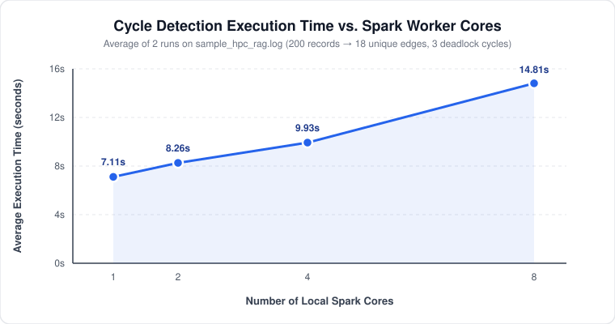
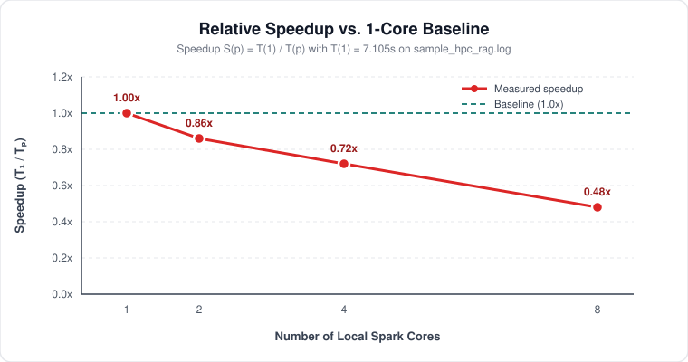

# Performance Benchmarks & Validation

This document summarizes functional validation across synthetic boundary graphs and multi-core scalability measurements for the cycle-detection engine.

---

## 1. Test Environment

| Parameter | Value |
| :--- | :--- |
| **Runtime** | Apache Spark 3.4.1 (PySpark, local mode) |
| **Python** | 3.10.12 |
| **JVM** | Java 11 |
| **Timing Scope** | Adjacency & initial frontier construction + iterative BFS cycle detection (excludes `SparkContext` startup, log parsing, timeline, and hotspot stages) |

---

## 2. Multi-Core Scalability Results

Each configuration was measured twice on the same compute node against `data/sample_hpc_rag.log` (200 log records deduplicated to 9 processes, 9 resources, 18 unique edges, and 3 deadlock cycles).

| Local Spark Cores ($p$) | Run 1 (s) | Run 2 (s) | Average (s) | Speedup $S(p)$ | Parallel Efficiency $E(p)$ |
| :---: | :---: | :---: | :---: | :---: | :---: |
| **1** | 6.88 | 7.33 | **7.11** | 1.00x | 100.0% |
| **2** | 8.83 | 7.69 | **8.26** | 0.86x | 43.0% |
| **4** | 10.16 | 9.69 | **9.93** | 0.72x | 17.9% |
| **8** | 14.90 | 14.72 | **14.81** | 0.48x | 6.0% |

> **Definitions:** Speedup $S(p) = T(1) / T(p)$ and Parallel Efficiency $E(p) = S(p) / p$, using $T(1) = 7.105\text{ s}$.

### Visualized Scaling Curves

### Engineering Observations

1. **Overhead Dominance on Small Graphs**: After deduplication, `sample_hpc_rag.log` yields only 18 unique edges. At this graph size, Spark's per-iteration coordination overhead — task scheduling, hash partitioning, RDD joins, shuffles, cache management, and driver synchronization — outweighs the parallelizable graph traversal work.
2. **Sub-Linear Scaling**: Adding more local worker threads increases shuffle partition count and scheduling latency without exposing enough independent edges to amortize the cost, causing runtime to rise from **7.11 s** (1 core) to **14.81 s** (8 cores).
3. **Workload Dependence**: On a separate 50,000-record synthetic graph (`50,000` unique independent edges, `0` cycles), execution completed in **5.44 s** at 4 cores because the BFS frontier terminated immediately after the first hop. Parallel speedup is expected primarily on large, densely connected graphs with deep multi-hop frontiers where per-iteration join work dominates Spark stage overhead.

---

## 3. Boundary & Correctness Test Matrix

In addition to `data/sample_hpc_rag.log`, the engine was validated against six synthetic graph fixtures exercising edge cases:

| Validation Fixture | Graph Characteristics | Expected & Observed Outcome |
| :--- | :--- | :--- |
| `branching_dag.log` | 99 edges, 18 processes, 18 resources; acyclic graph with branching paths | `0` cycles detected |
| `max_cycle.log` | Single 24-edge cycle (largest even bipartite cycle within the 25-edge cap) | `1` cycle detected |
| `over_limit_cycle.log` | Single 26-edge cycle (exceeds default 25-edge cap) | `0` cycles detected |
| `no_deadlock.log` | 3-edge acyclic graph | `0` cycles detected |
| `zero_degree.log` | 2 edges containing nodes with zero request/wait degree | Contention ranking includes degree `0` nodes |
| `synthetic_50000.log` | 50,000 records and 50,000 unique edges (`50,000 P`, `50,000 R`) | `0` cycles detected; completed cleanly in `5.44 s` at 4 cores |
